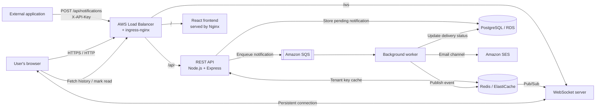

<div align="center">

# PulseNotify

### A cloud-native, event-driven notification platform built with AWS, Kubernetes, Terraform, and GitOps

[](https://nodejs.org/)
[](https://www.docker.com/)
[](https://kubernetes.io/)
[](https://www.terraform.io/)
[](https://aws.amazon.com/)
[](https://argo-cd.readthedocs.io/)

**Accept a notification once. Process it asynchronously. Deliver it in real time. Keep a durable history.**

</div>

---

## Overview

**PulseNotify** is a multi-tenant notification service that lets applications send notifications through a REST API. Notifications are persisted in PostgreSQL, queued for asynchronous processing, and delivered to connected browsers over WebSockets. The worker can also route email notifications through Amazon SES.

The project brings application engineering and platform engineering together in one repository: four containerized services, AWS infrastructure provisioned with Terraform, Kubernetes workloads on Amazon EKS, centralized secret delivery, and a pull-based GitOps deployment workflow with Argo CD.

> **Project focus:** demonstrate how a small distributed application can be packaged, provisioned, deployed, and operated using cloud-native patterns. This is a portfolio/reference project—not a claim that every production-hardening task is complete. See [Current scope and hardening backlog](#current-scope-and-hardening-backlog).

## Why this architecture?

A notification API should acknowledge a request quickly without waiting for every downstream delivery step. PulseNotify separates request acceptance from notification processing using Amazon SQS. This allows the API and worker to scale independently and gives the system a place to retry failed work.

- **Asynchronous processing:** the API queues work and returns `202 Accepted` rather than waiting for delivery.
- **Real-time delivery:** a WebSocket service pushes notifications to connected users.
- **Durable history:** PostgreSQL stores notifications and their delivery state.
- **Independent services:** frontend, API, WebSocket server, and worker are built and deployed separately.
- **Infrastructure as code:** Terraform manages the AWS infrastructure.
- **Safer cloud identity:** workloads use IAM Roles for Service Accounts (IRSA); GitHub Actions uses OIDC to obtain temporary AWS credentials.
- **GitOps delivery:** Argo CD reconciles Kubernetes resources from Git, with a reviewed pull request controlling image promotion.

## Architecture



### Notification lifecycle

1. A tenant's backend sends `POST /api/notifications` with its `X-API-Key` header.
2. The API checks the tenant key in Redis first and falls back to PostgreSQL on a cache miss. It validates the request and stores a notification with a pending status.
3. The API publishes the work item to SQS and responds with `202 Accepted`.
4. A worker polls SQS, processes the notification, publishes a Redis Pub/Sub event for real-time delivery, and sends email through SES when the email channel is selected.
5. WebSocket server instances subscribe to Redis. The instance holding the user's connection sends the notification to the browser.
6. The worker updates the durable delivery status and deletes the SQS message after successful processing. Failed messages can be retried and eventually routed to a dead-letter queue, subject to queue policy.
7. The browser can retrieve notification history and mark notifications as read through the REST API.

**Design trade-off:** Redis Pub/Sub is transient. PostgreSQL remains the source of truth for notification history, but a real-time push can be missed if no WebSocket subscriber is available at publish time.

## Services and responsibilities

| Component | Responsibility |
|---|---|
| `frontend` | React-based browser UI, packaged as static assets and served by Nginx. |
| `api` | REST endpoints, tenant API-key authentication, request validation, persistence, and enqueueing work. |
| `ws-server` | Maintains WebSocket connections and pushes Redis Pub/Sub events to connected clients. |
| `worker` | Consumes SQS messages, publishes real-time events, updates PostgreSQL delivery status, and handles the email channel. |
| PostgreSQL / Amazon RDS | Durable tenant and notification data. |
| Redis / Amazon ElastiCache | Tenant-key lookup cache and Pub/Sub transport between workers and WebSocket servers. |
| Amazon SQS + DLQ | Decouples API requests from processing and provides a retry/failure path. |
| Amazon SES | Email delivery for the email notification channel. |

## Technology stack

| Area | Technologies |
|---|---|
| Application | Node.js, Express, React, Nginx, WebSockets |
| Data and messaging | PostgreSQL, Redis, Amazon SQS, Amazon SES |
| Containers | Docker, Docker Compose, Amazon ECR |
| Cloud platform | AWS VPC, Amazon EKS, EC2 managed node groups, RDS, ElastiCache, IAM |
| Infrastructure as code | Terraform, Terraform modules, remote state in S3 |
| Orchestration and ingress | Kubernetes, ingress-nginx, Helm, cert-manager |
| Secrets and workload identity | AWS Secrets Manager, External Secrets Operator, IRSA, GitHub OIDC |
| Delivery | GitHub Actions, Argo CD, Git-based promotion via pull request |
| Testing and logging | Jest, Supertest, Winston structured JSON logs |
| Monitoring foundation | Prometheus Operator / kube-prometheus-stack components; application-level metrics and alert routing require further wiring |

## Repository layout

```text
pulsenotify/
├── services/
│   ├── api/                    # REST API and database/queue integration
│   ├── ws-server/              # WebSocket connection service
│   ├── worker/                 # SQS consumer and notification delivery
│   └── frontend/               # React UI and Nginx configuration
├── infra/
│   ├── modules/vpc/             # Reusable VPC module
│   └── environments/production/ # Terraform root for the AWS environment
├── k8s/
│   ├── base/                    # Kubernetes deployments, services, ingress, config
│   └── overlays/production/     # Production overlay location (currently a placeholder)
├── argocd/                      # Argo CD application definition
├── .github/workflows/           # CI pipeline
├── docker-compose.yml           # Local multi-container environment
└── README.md
```

> The Terraform environment currently defines several resources directly in the production root module. The directory names above describe the repository organization; they do not imply that every listed infrastructure subdirectory contains a completed reusable module.

## Run locally

### Prerequisites

- Docker Engine and Docker Compose v2
- Git
- An AWS SQS queue and AWS credentials for the complete notification-send flow, or a local SQS-compatible emulator such as LocalStack configured for the application
- Amazon SES configuration and a verified sender identity if testing email delivery against AWS

### 1. Clone the repository

Replace the placeholder with your GitHub repository URL:

```bash
git clone https://github.com/<YOUR_GITHUB_USERNAME>/pulsenotify.git
cd pulsenotify
```

### 2. Configure local environment variables

The Compose file reads `SQS_QUEUE_URL` from the shell environment or a root-level `.env` file. Create that file locally:

```dotenv
SQS_QUEUE_URL=<your-sqs-queue-url>
```

Do not commit `.env` or real credentials. The supplied Compose configuration uses local-only PostgreSQL credentials and plain Redis for development; do not reuse those values in a deployed environment.

**AWS credentials note:** the default local Compose configuration does not pass AWS credentials into the application containers and does not create a local SQS queue. Before expecting notification sends to complete, configure credentials securely for the relevant containers or configure an SQS emulator and its endpoint. If the queue integration is not configured, the local stack can start while the full send path remains incomplete.

### 3. Build and start the services

```bash
docker compose up --build
```

Local endpoints:

| Service | URL |
|---|---|
| Frontend | `http://localhost:8080` |
| API | `http://localhost:3000` |
| WebSocket server | `ws://localhost:3001` |
| PostgreSQL | `localhost:5432` |
| Redis | `localhost:6379` |

### 4. Create a test tenant

In a second terminal:

```bash
docker compose exec postgres psql -U pulsenotify -d pulsenotify \
  -c "INSERT INTO tenants (name) VALUES ('demo') RETURNING id, api_key;"
```

Copy the generated `api_key` for the next step. Keep it private.

### 5. Send a test notification

With SQS and AWS credentials (or a configured SQS emulator) available to the API and worker, run:

```bash
curl -i -X POST http://localhost:3000/api/notifications \
  -H "Content-Type: application/json" \
  -H "X-API-Key: <API_KEY>" \
  -d '{
    "userId": "user-123",
    "title": "Hello from PulseNotify",
    "body": "Your first notification is ready."
  }'
```

A successfully accepted request returns `202 Accepted`. Open the frontend and connect a test client to the WebSocket endpoint to observe real-time delivery. The documented cluster connection shape is `ws://<LOAD_BALANCER_HOST>/ws?userId=<USER_ID>&tenantId=<TENANT_ID>`. Treat the query parameters as identifiers, not authentication; WebSocket authentication is a hardening item.

To inspect the stack:

```bash
docker compose ps
docker compose logs -f api worker ws-server
```

Stop the stack with `Ctrl+C`, then:

```bash
docker compose down
```

To remove the local PostgreSQL volume as well, use `docker compose down -v`. **This deletes local database data.**

## AWS deployment model

The cloud environment is provisioned primarily with Terraform and runs the workloads on Amazon EKS.

### Infrastructure

The Terraform configuration provisions the core network and application dependencies, including:

- A VPC with public and private subnets across two Availability Zones
- NAT gateways and routing for private workloads to reach required external/AWS endpoints
- Amazon EKS and managed worker nodes in private subnets
- Amazon RDS for PostgreSQL and Amazon ElastiCache for Redis
- SQS notification and dead-letter queues
- Amazon ECR repositories for the four service images
- IAM roles and policies for workloads and CI
- An S3-backed Terraform state backend and state-locking configuration
- Helm-managed cluster components such as ingress-nginx and cert-manager

The default configuration uses `ap-south-1` (Mumbai). Confirm the region, instance types, quotas, account-specific identifiers, and resource sizes against your own Terraform variables before applying it.

### Secret delivery and AWS permissions

Application secrets are stored in AWS Secrets Manager rather than in Git. External Secrets Operator retrieves them and creates the Kubernetes Secret consumed by the workloads. IRSA grants AWS permissions to the relevant Kubernetes service accounts without embedding long-lived AWS access keys in pods. GitHub Actions uses OIDC to assume its deployment role and receive temporary credentials.

### Deploying changes

1. Review infrastructure changes with `terraform plan` before applying them.
2. Build and validate application changes through a pull request.
3. After merge, GitHub Actions runs the configured tests and builds the service images in parallel.
4. Images are pushed to ECR with commit-SHA tags.
5. The workflow opens a pull request updating the Kubernetes image tags.
6. Merge that promotion pull request to make the change eligible for Argo CD synchronization.
7. Argo CD reconciles the Git-defined manifests, and Kubernetes rolls out the new pods.

This separates application-code review from deployment approval and keeps the intended deployment state reviewable in Git history.

> **AWS cost warning:** EKS, EC2, RDS, ElastiCache, NAT gateways, load balancers, and data transfer can incur ongoing charges even when the demo is idle. Review the AWS estimate before `terraform apply`, and use the project's teardown runbook when the environment is no longer needed. Destroying the stack is a destructive operation and requires checking persistent resources and stored data first.

## API quick reference

| Method | Path | Purpose |
|---|---|---|
| `POST` | `/api/notifications` | Authenticate a tenant, persist a notification, and enqueue processing. |
| `GET` | `/api/notifications` | Retrieve notification history. |
| `PATCH` | `/api/notifications/:id/read` | Mark a notification as read. |
| `GET` | Health endpoint | Check service and dependency health; the documented endpoint is `/health`. |

Tenant API calls use the `X-API-Key` header. The API returns `202 Accepted` when a notification has been accepted for asynchronous processing; that response is not a guarantee that the user has already received the notification.

## Current scope and hardening backlog

The project demonstrates the core asynchronous delivery architecture and AWS/Kubernetes deployment path. Some production-level controls remain follow-up work; they should not be described as completed until they have been implemented and verified.

- **WebSocket security:** add robust connection authentication and avoid exposing tenant API credentials to browser clients.
- **Credential storage:** hash API keys at rest and review key rotation/revocation behavior.
- **Failure handling:** consistently catch asynchronous API errors, make worker processing idempotent, handle graceful shutdown, and test retry/duplicate-delivery scenarios.
- **Health probes:** split process liveness from dependency readiness so a dependency outage does not trigger unnecessary restarts.
- **Database operations:** run schema migrations as a controlled one-off job rather than on every API pod startup; review connection limits and TLS certificate verification.
- **Observability:** add and verify application `/metrics` instrumentation, fix ServiceMonitor selectors and alert expressions, configure Alertmanager receivers, and implement a log shipping pipeline.
- **Infrastructure hardening:** configure real-domain TLS, restrict EKS API endpoint access, add appropriate network/policy controls, and review IAM and Kubernetes RBAC permissions.
- **Availability and scaling:** evaluate multi-AZ database deployment, Redis replication/failover, and node autoscaling against a defined availability and budget target.
- **Supply-chain hygiene:** use a supported Node.js LTS, pin and scan container base images, add `.dockerignore` files, run containers as non-root where possible, and commit `.terraform.lock.hcl` for provider reproducibility.
- **Testing:** expand coverage beyond the API's current test job to include worker failure paths, Redis integration, and end-to-end notification delivery.

These are intentional engineering follow-ups, not features to assume are already working in the current deployment.

## What this project demonstrates

- Designing an event-driven service with a queue-based processing boundary
- Separating short-lived HTTP requests from long-lived WebSocket connections
- Containerizing a multi-service Node.js application
- Provisioning AWS infrastructure with Terraform and remote state
- Deploying workloads on Kubernetes with readiness checks, rolling updates, and an API HPA
- Applying least-privilege workload identity patterns with IRSA and GitHub OIDC
- Delivering secrets from AWS Secrets Manager through External Secrets Operator
- Implementing a pull-based GitOps deployment workflow with Argo CD
- Troubleshooting practical deployment failures across IAM trust policies, image tagging, Kubernetes manifests, and dependency readiness

## Feedback and contributions

Issues and pull requests are welcome. For changes that affect infrastructure or deployment behavior, include the reason for the change, the validation performed, and any impact on cost or security.

---

<div align="center">

**PulseNotify — dependable notification workflows, from API request to delivery.**

</div>
